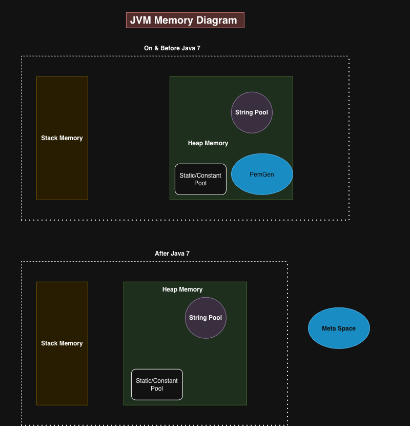
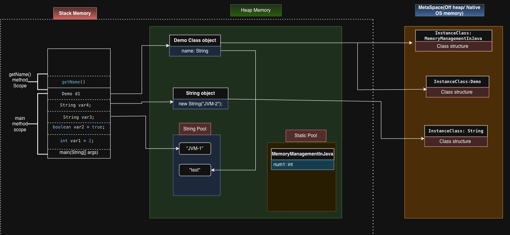
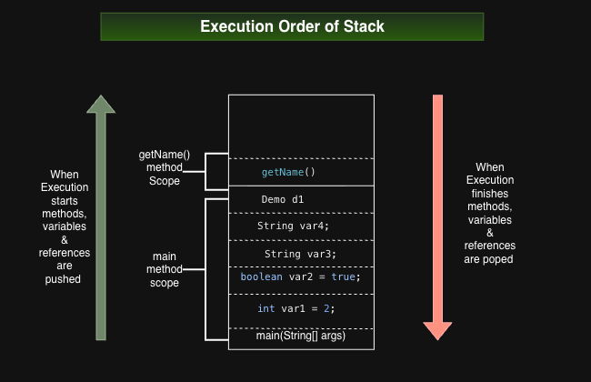
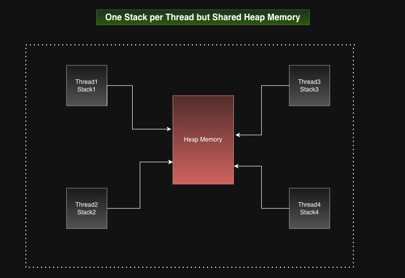
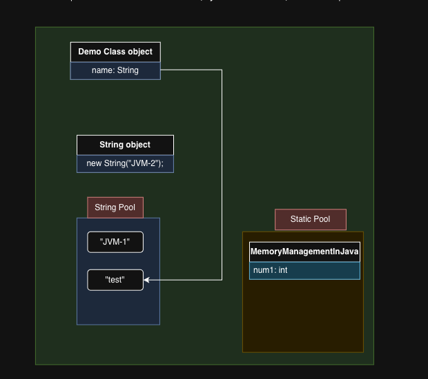
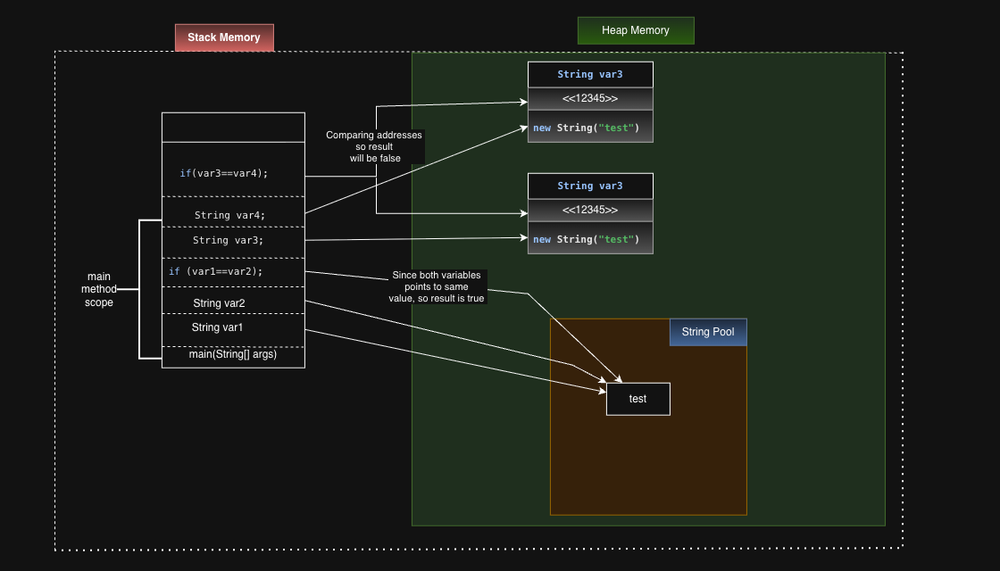
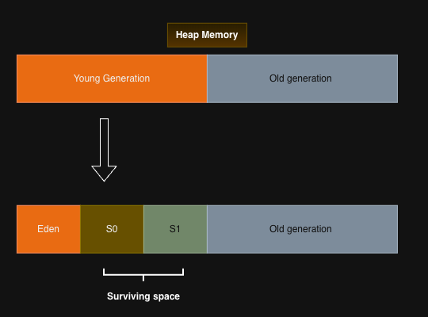
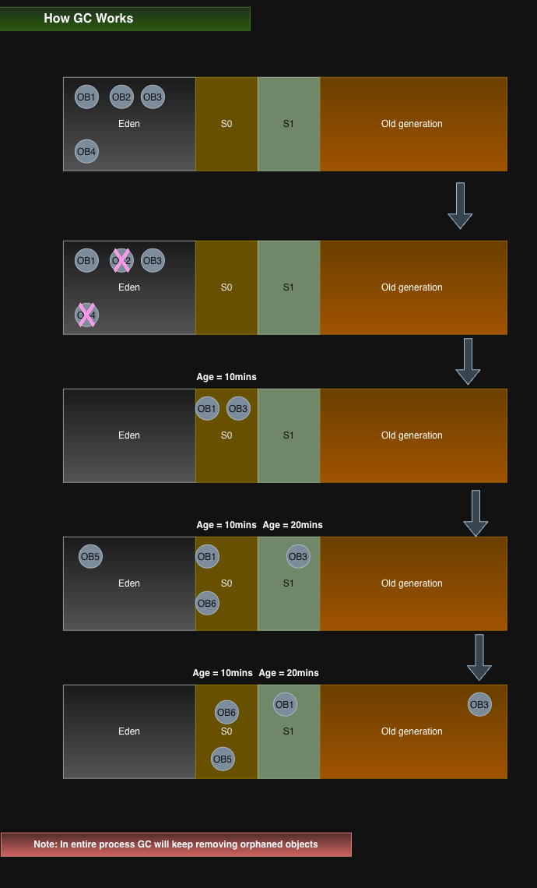

# JVM Memory Management

Learn how Java stores method frames, objects, strings, and class metadata, and
how garbage collection reclaims memory. This guide includes PNG diagrams, Java
examples, and commands for investigating memory problems.

[Open the larger-text browser version](java-memory-management.html).

## Contents

1. [Memory overview](#memory-overview)
2. [Stack memory](#stack-memory)
3. [Heap memory and references](#heap-memory-and-references)
4. [Strings and the string pool](#strings-and-the-string-pool)
5. [Metaspace](#metaspace)
6. [Garbage collection](#garbage-collection)
7. [Garbage collectors](#garbage-collectors)
8. [Diagnosing memory problems](#diagnosing-memory-problems)
9. [Diagram resources](#diagram-resources)

## Memory overview



The following areas form the core memory model used in this guide:

| Area | Purpose | Scope |
|---|---|---|
| JVM stack | Frames for active method calls, including local variables and operand stacks | One per thread |
| Heap | Objects and arrays | Shared by threads |
| Metaspace | Class metadata in HotSpot | Native memory managed by the JVM |

The JVM also has program counters and native method stacks. Its specification
leaves physical layout and optimizations to implementations. See the
[JVM runtime data areas specification](https://docs.oracle.com/javase/specs/jvms/se17/html/jvms-2.html#jvms-2.5).

**Version history:** interned strings moved from PermGen into the main heap in
**JDK 7**. PermGen was removed in **JDK 8**, with class metadata moving to native
memory. The diagram groups Java 7 with earlier releases; use these version
boundaries when reading it. Sources: [JDK 7 VM changes](https://docs.oracle.com/javase/7/docs/technotes/guides/vm/enhancements-7.html)
and [HotSpot class metadata](https://docs.oracle.com/en/java/javase/25/gctuning/other-considerations.html).

## Stack memory

A method invocation creates a frame; returning discards it. Frames contain
local variables, an operand stack, and information used for linking and return.
Calls unwind in **LIFO** order: the most recent call returns first.



In the example, `main()` holds primitive local values and
references such as `var3`, `var4`, and `d1`. Calling `d1.getName()` creates
another frame. Its return removes that frame while `main()` continues. A
reference can also be stored in an object's field or an array, so references
are not confined to stacks. Instance primitive fields belong to their objects.



Excessive call depth can cause `StackOverflowError`. Releasing a frame does not
immediately free every object it referenced: an object may remain reachable
elsewhere. See [JVM frames](https://docs.oracle.com/javase/specs/jvms/se17/html/jvms-2.html#jvms-2.6).

### One stack per thread



Each thread has its own stack, while objects in the heap can be shared.
Concurrent changes to shared objects require an appropriate synchronization
strategy.

## Heap memory and references



The arrows show reachability: `d1` refers to a `Demo` object, which has a `name`
field referring to a string. Separate variables can refer to the same object.

The “Static Pool” box is a conceptual grouping of class-level state, rather than
a standard named heap generation. Likewise, the runtime constant pool is
per-class linking information and should not be confused with the string pool.

The following example illustrates local values, object references, and a
nested method call:

```java
public class MemoryManagementInJava {
    static int num1 = 10;

    public static void main(String[] args) {
        int var1 = 2;
        boolean var2 = true;
        String var3 = "JVM-1";
        String var4 = new String("JVM-2");
        Demo d1 = new Demo();
        String name = d1.getName();
    }
}

class Demo {
    String name = "test";

    String getName() {
        return name;
    }
}
```

This is a conceptual memory model, not a promise that optimized machine code
allocates every value exactly as drawn.

## Strings and the string pool



String literals are interned. `new String("test")` creates a distinct string
object; `==` compares object identity and `equals()` compares string content.
`intern()` returns the canonical pooled representation. See the
[String API](https://docs.oracle.com/en/java/javase/17/docs/api/java.base/java/lang/String.html#intern()).

```java
String var1 = "test";
String var2 = "test";
String var3 = new String("test");
String var4 = new String("test");

System.out.println(var1 == var2);        // true
System.out.println(var3 == var4);        // false
System.out.println(var1 == var3);        // false
System.out.println(var1.equals(var3));   // true
System.out.println(var1 == var3.intern()); // true
```

In the diagram, the second heap object labeled `var3` represents the object
referenced by `var4`. Addresses are illustrative; `==` tests reference identity.

## Metaspace

HotSpot stores class metadata in Metaspace, using native memory outside the
Java object heap. The combined memory diagram shows how heap objects relate
to their class structures.

Class metadata can be reclaimed when classes are unloaded. Retained class
loaders and repeated dynamic class generation can lead to Metaspace growth.
An `OutOfMemoryError: Metaspace` can also result from a restrictive limit; the
message alone does not establish a class-loader leak. See
[HotSpot metadata allocation and reclamation](https://docs.oracle.com/en/java/javase/25/gctuning/other-considerations.html).

## Garbage collection

Garbage collection reclaims objects that are no longer reachable through the
references relevant to the collector. An object can be unreachable even if
other unreachable objects still refer to it; cyclic references alone do not
prevent collection.

Marking generally identifies **live** objects. Sweeping reclaims unused
storage; copying or compaction can move surviving objects. These are different
operations, and collectors combine them in different ways.

### Young and old generations



This image represents a traditional generational collector layout. Newly
allocated objects commonly enter Eden. Surviving young collections increases
an object's age; older survivors may be promoted into the old generation.
Age counts collections survived, **not elapsed minutes**. The exact layout and
promotion decisions depend on the collector. See
[Oracle's generational collection guide](https://docs.oracle.com/javase/8/docs/technotes/guides/vm/gctuning/generations.html).

### Following the example objects



1. `OB1` through `OB4` are initially drawn in Eden.
2. `OB2` and `OB4` become unreachable and can be reclaimed.
3. Live objects survive collection and move into survivor storage.
4. New objects enter Eden; later collections reclaim dead objects and retain survivors.
5. Some survivors eventually move into old-generation storage, where they remain subject to collection.

**Diagram note:** read the age labels as survived collection counts, not
minutes. In a copying young collector, S0 and S1 normally alternate roles
between collections rather than forming successive timed stages. Promotion
may occur sooner if survivor space is insufficient. The diagram illustrates
survival and promotion rather than an exact collector trace.

## Garbage collectors

| Collector or category | Main idea | Clarification |
|---|---|---|
| Serial GC | Uses a single GC worker for collection | Collection pauses application execution |
| Parallel GC | Uses multiple GC workers | Parallel collection still includes application pauses |
| Concurrent collectors | Perform some GC work alongside application threads | Concurrent work does not imply zero pauses |
| G1 GC | Collects heap regions and performs much marking concurrently | Includes stop-the-world evacuation pauses; its pause target is a goal |

Concurrency describes how collection work overlaps with application execution;
it does not guarantee zero pauses. G1 uses regions rather than one fixed
contiguous Eden/S0/S1 arrangement. See
[Oracle's G1 guide](https://docs.oracle.com/en/java/javase/17/gctuning/garbage-first-g1-garbage-collector1.html).

## Diagnosing memory problems

CPU spikes, rising post-GC heap usage, long response times, and out-of-memory
errors can indicate memory pressure. Correlate these symptoms with allocation
rates, GC pauses, and retained objects before deciding on a fix.

### Capture logs and dumps

For JDK 9 and later, a startup command can enable unified GC logging and an
automatic heap dump on an out-of-memory error. Create a writable output
directory first:

```bash
mkdir -p logs
java \
  -Xlog:gc*,gc+phases=debug:file=logs/gc.log:time,uptime,pid:filecount=5,filesize=100M \
  -XX:+HeapDumpOnOutOfMemoryError \
  -XX:HeapDumpPath=logs \
  -jar app.jar
```

Heap dumps may be large. Options and their behavior are documented in the
[JDK 17 java command reference](https://docs.oracle.com/en/java/javase/17/docs/specs/man/java.html).

For a running process, replace `12345` with its PID:

```bash
jstat -gcutil 12345 1000
jcmd 12345 GC.class_histogram
jcmd 12345 GC.heap_dump logs/heapdump.hprof
```

Histograms and heap dumps can have significant impact on the running process;
use them deliberately. See [jcmd diagnostics and impact levels](https://docs.oracle.com/en/java/javase/17/docs/specs/man/jcmd.html).

### Interpret the evidence

| Observation | What to investigate |
|---|---|
| Rising heap baseline after comparable collections | Long-lived retained objects, unbounded caches, growing collections |
| Frequent young collections | High allocation rate and short-lived temporary objects |
| Long pauses or frequent full collections | Heap pressure, promotion, allocation size, and collector behavior |
| Metaspace growth | Class count, generated classes, class-loader retention, and limits |
| Java heap space error | Live data size relative to available heap; retention paths |

In a heap analyzer, inspect the **dominator tree**, **retained heap**, and
**paths to GC roots**. Shallow size measures an individual object; retained
size includes objects kept alive through it. Check cache eviction, retained
collections, background threads, and class-loader lifecycle. Increasing a memory limit may delay failure without fixing retention.

## Diagram resources

- [Editable draw.io diagram](src/main/resources/java-memory-mangement.drawio)
- [Complete diagram PNG](java-memory-mangement.drawio.png)
- [Individual PNG diagrams](src/main/resources/images/)

The images use a simplified HotSpot memory model. Version-specific labels and
collector behavior are clarified in the relevant sections above.
